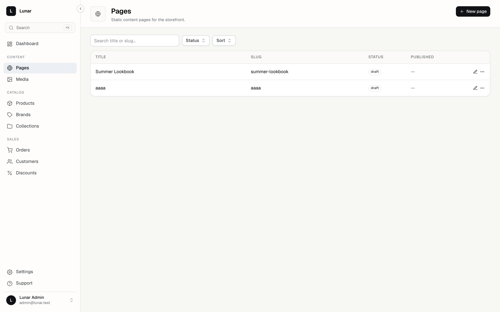
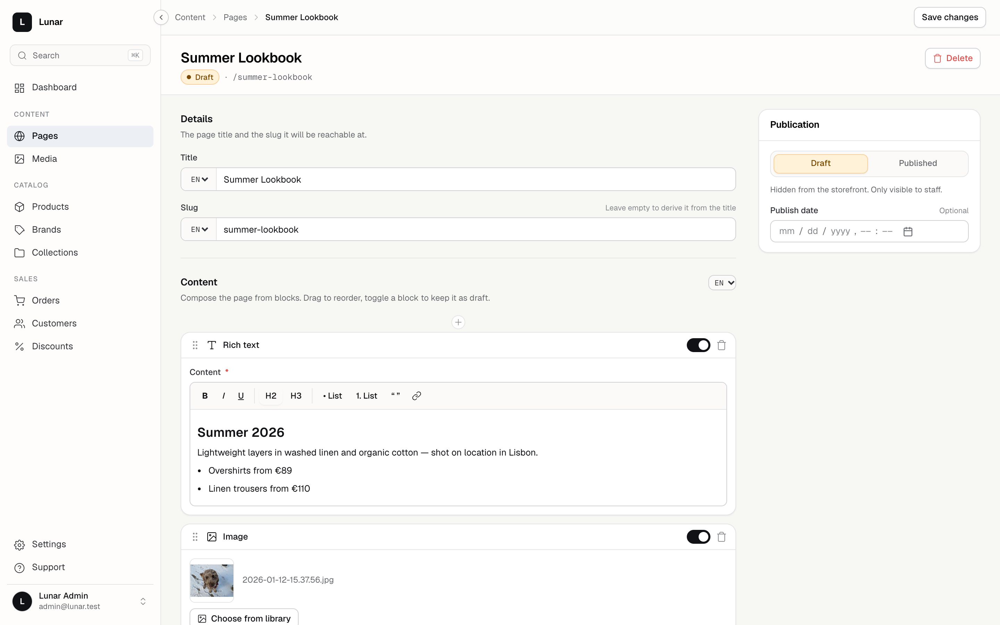
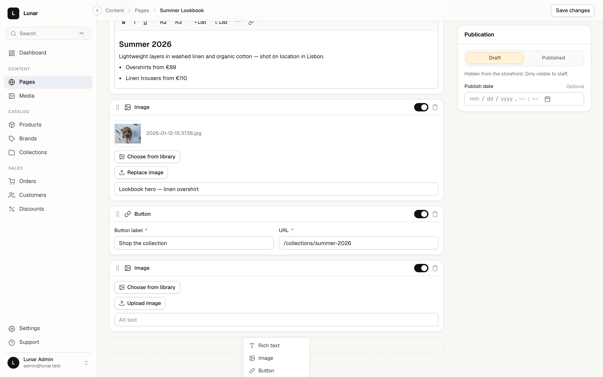

# Lunar CMS add-on

Page builder for the Lunar admin panel: pages with per-locale title/slug and a
block-based content editor. Blocks are **schema-driven** — a PHP declaration
produces the insert-menu entry, the rendered inputs, the defaults and the
validation rules. Most new block types need zero JavaScript.

## Screenshots

| Pages index | Schema-driven block editor | Insert menu |
|---|---|---|
|  |  |  |

## Setup

The package is wired into the app via a `path` composer repository
(`packages/cms`, namespace `LunarCms\`). `CmsServiceProvider` registers the
panel `Section` and routes under `/panel/cms`.

```bash
cd packages/cms
npm install        # once — deps externalize against panel globals
npm run build      # produces build/ (committed, served via /vendor/lunar-panel/cms symlink)
npm run dev        # vite build --watch while editing JS
```

PHP formatting after changes: `vendor/bin/pint --dirty --format agent` from the
app root. Tests: `php artisan test --filter=Cms`.

## Architecture

```
BlockRegistry::types()          PageController            BlockEditor.vue
┌─────────────────────┐   Inertia ┌───────────────┐        ┌──────────────────────────┐
│ label, icon         │ ─prop──▶  │ blockTypes    │ ────▶  │ insert menu, labels,     │
│ fields[]      ──────┼─────────▶ │  (schema)     │        │ defaults, card chrome    │
│   or editor + rules │           └───────────────┘        └──────────┬───────────────┘
└─────────────────────┘                                               │ per block
                                            ┌─────────────────────────┴──────────────┐
                                            │ editor set? → customEditors[name]      │
                                            │ fields set? → BlockFields.vue          │
                                            │   → fieldTypes[field.type] adapter     │
                                            └────────────────────────────────────────┘
```

`PageRequest` derives validation from the same registry
(`blocks.{locale}.{i}.data.{key}`), so a field's rules live exactly once — in
the field declaration. Stored data shape is `{id, type, enabled, data}` per
block, nested under `pages.blocks` per locale. No data migration is needed when
adding a type.

## Adding a block (pure PHP)

Declare it in `packages/cms/src/Blocks/BlockRegistry.php`:

```php
'quote' => [
    'label' => 'Quote',
    'icon' => 'fileText',
    'fields' => [
        [
            'key' => 'text',
            'type' => 'textarea',
            'label' => 'Quote',
            'required' => true,
            'cols' => 2,
        ],
        [
            'key' => 'cite',
            'type' => 'text',
            'label' => 'Citation',
            'required' => false,
            'cols' => 1,
            'rules' => ['max:120'],
        ],
        [
            'key' => 'variant',
            'type' => 'select',
            'label' => 'Style',
            'required' => true,
            'cols' => 1,
            'config' => [
                'options' => [
                    ['label' => 'Default', 'value' => 'default'],
                    ['label' => 'Highlight', 'value' => 'highlight'],
                ],
            ],
        ],
    ],
],
```

That is the whole job: the type appears in the insert menu, renders inputs,
seeds defaults and validates — no Vue changes. `icon` must be one of the names
in the panel `Icon.vue`'s `ICONS` map (closed set — `fileText`, `image`,
`link`, `type`, `flag`, `palette`, …); unknown names render nothing.

### Field schema keys

| Key        | Meaning |
|------------|---------|
| `key`      | Property written into `block.data` |
| `type`     | One of the registered field types (below) |
| `label`    | Shown above the input |
| `required` | `required` vs `nullable` in derived rules; asterisk in the UI |
| `cols`     | Columns in the 2-column grid: `1` = half width, `2` = full (default) |
| `config`   | Type-specific options — e.g. `options` for `select` (also feeds `Rule::in`) |
| `default`  | Initial value for new blocks (falls back to the type's implicit default) |
| `rules`    | Extra Laravel rules merged after the derived base |

### Built-in field types

| Type       | Renders     | Base rule | Notes |
|------------|-------------|-----------|-------|
| `text`     | TextInput   | `string`  | |
| `url`      | TextInput (`type=url`) | `string` | |
| `number`   | TextInput (`type=number`) | `numeric` | empty → `null`, else coerced to `Number` |
| `textarea` | Textarea    | `string`  | |
| `select`   | Select      | `Rule::in(config.options)` | options via `config.options` |
| `toggle`   | Toggle      | `boolean` | |
| `richtext` | TipTap editor | `string` | stores HTML |

Validation is derived as `[required|nullable, <base>, ...custom rules]` — the
`cta` type's `['required', 'string', 'max:255']` is a derived example.

## Custom block editor (escape hatch)

When a block needs behavior a schema can't express (the `image` block needs a
media picker), declare it with `editor` + `rules` + `defaults` instead of
`fields`:

```php
'image' => [
    'label' => 'Image',
    'icon' => 'image',
    'editor' => 'image',          // name looked up in customEditors
    'rules' => [...],
    'defaults' => ['media_id' => null, 'alt' => ''],
],
```

Then register the component in `resources/js/blocks/index.js`:

```js
export const customEditors = {
    image: ImageBlock,
    myblock: MyBlock,
};
```

Editor contract — see `components/blocks/ImageBlock.vue` for a full example:

```ts
defineProps<{
    data: Record<string, unknown>;            // block.data — write through v-model:data
    errors?: Record<string, string>;          // { fieldKey: message }, already scoped to this block
    media: Record<number, MediaRef>;          // resolved media for picker editors
    mediaUploadUrl?: string;
    mediaPickerUrl?: string | null;
    mediaLibraryUploadUrl?: string | null;
}>();

defineEmits<{ 'update:data': [value: ...] }>();
```

Update via `emit('update:data', {...props.data, alt: value})` — `BlockEditor`
binds `v-model:data`.

## Adding a field type (JS)

Field types are components resolved through `fieldTypes` in
`resources/js/components/fields/index.ts` — the JS mirror of `BlockRegistry`.

1. Create `components/fields/MyField.vue` implementing the uniform contract:

```vue
<script setup lang="ts">
import type { BlockField } from './types';

defineProps<{
    field: BlockField;        // the schema entry: key, type, label, config…
    modelValue?: unknown;     // current data[field.key]
    invalid?: boolean;        // a validation error exists for this key
}>();

const emit = defineEmits<{ 'update:modelValue': [value: string] }>();
</script>

<template>
    <!-- normalize your input's props/events onto the contract -->
</template>
```

2. Register it — either statically in `fieldTypes`:

```ts
export const fieldTypes = shallowReactive<Record<string, Component>>({
    // ...
    color: ColorField,
});
```

or at runtime from another add-on (it is `shallowReactive`, so late
registration re-renders open forms):

```ts
import { registerFieldType } from 'cms/components/fields';
registerFieldType('color', ColorField);
```

3. Use `'type' => 'color'` in the PHP schema. Add a base rule for the new type
in `BlockRegistry::fieldRules()` if `string` isn't the right default.

`BlockField` lives in `components/fields/types.ts`; `fieldString()` there is
the shared `unknown → string` coercion for text-like inputs.

## Conventions that will bite you

- **Shared compiled CSS.** Add-ons share the panel's Tailwind build — a utility
  class only exists if the panel emitted it. `cols` therefore renders as inline
  `grid-column`, and genuinely new utilities go in the `<style>` injected by
  `addon.ts`. Check `getComputedStyle` or the injected stylesheet before
  inventing a class.
- **Public surface only.** Import panel pieces from `@lunarphp/panel` (the
  `ui.ts` barrel → `window.LunarPanelUI`). `RichTextEditor` is *not* exported —
  `RichTextField` wraps TipTap directly.
- **Externalized deps.** Vue, Inertia, vue-i18n and `@lunarphp/panel` resolve
  to panel globals — never bundle them. `@tiptap/*` resolves from the app root's
  `node_modules`.
- **Reactivity is direct mutation.** Field adapters emit `update:modelValue`;
  `BlockFields` writes `data[field.key]` on the form's reactive object. No
  per-block emit wiring — keep it that way.
- **Formatting.** Declaration arrays one key per line
  (`.ai/rules/packages.md`) — Pint accepts single-line arrays but they don't
  diff or read well.
